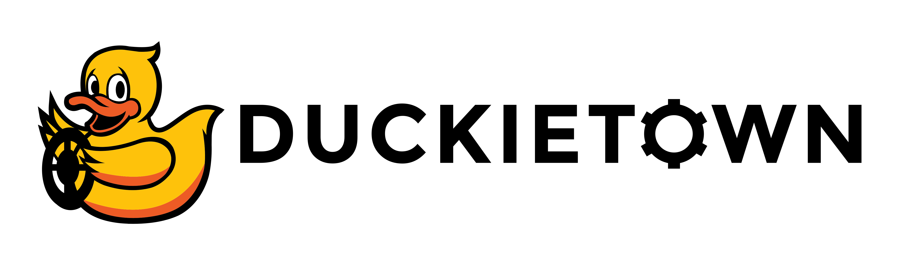
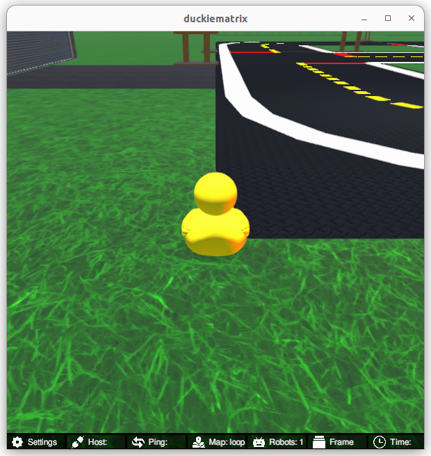
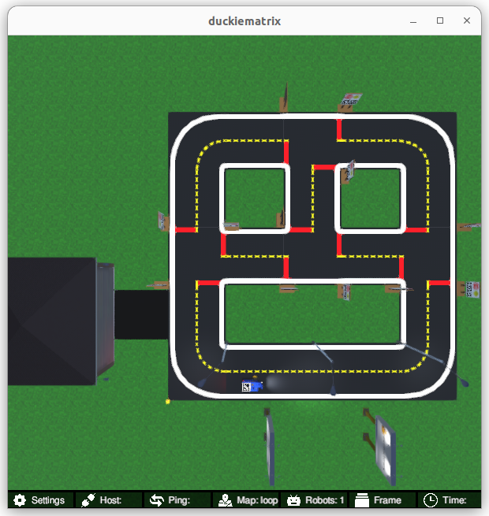

<p align="center">
<a href="https://duckietown.com"></a>
</p>

# **Learning Experience (LX): ROS 2 Basics**

Find the most up-to-date instructions on [how to run LXs on the Duckietown manual](https://docs.duckietown.com/ente/duckietown-manual/60-learning-experiences/lx-general-procedure.html).

# About these activities

In this learning experience, you will learn the basics of [ROS 2 (Robot Operating System 2)](https://docs.ros.org/en/jazzy/)
and use them on a Duckiebot: how nodes, topics, messages, services and parameters form a graph, how
the Duckiebot's ROS 2 stack discovers your code through its zenoh router, how a `colcon` workspace
and an `ament_python` package are organised, and how to write publishers and subscribers in `rclpy`.
By the end you will have written a ROS 2 node that drives the Duckiebot, either in the Duckiematrix
or on real hardware.

This LX uses ROS 2 **Jazzy** with the `rmw_zenoh_cpp` middleware, as shipped in the Duckietown `ente`
distribution. If you are looking for the ROS 1 (Noetic) version, see `lx-ros-basics`.

# Instructions

**NOTE:** All commands below are intended to be executed from the root directory of this exercise (i.e., the directory containing this README).

The recommended way to use this repository is to make a fork and then clone that fork. This can be done through
the GitHub web interface. However, you are also free to simply clone this repository and get started.

This exercise can be run on a real Duckiebot or on a virtual Duckiebot in the Duckiematrix.

## 1. Make sure your exercise is up-to-date

In case your instructor has updated something in this repo, you should make sure everything is up to date (this assumes
that you created a fork):

    git remote add upstream git@github.com:duckietown/lx-ros2-basics
    git pull upstream <branch>

**NOTE:** Example instructions to fork a repository and configure to pull from upstream can be found in the
[duckietown-lx repository README](https://github.com/duckietown/duckietown-lx/blob/mooc2022/README.md).


## 2. Make sure your system is up-to-date

- 💻 Always make sure your Duckietown Shell is updated to the latest version. See [installation instructions](https://github.com/duckietown/duckietown-shell)

- 💻 Update the shell commands: `dts update`

- 💻 Update your laptop/desktop: `dts desktop update`

- 🚙 Update your Duckiebot: `dts duckiebot update ROBOTNAME`
(where `ROBOTNAME` is the name of your Duckiebot - real or virtual.)


## 3. Work on the exercise

### Launch the code editor

Open the code editor by running the following command,

```
dts code editor
```

Wait for a URL to appear on the terminal, then click on it or copy-paste it in the address bar
of your browser to access the code editor. The first thing you will see in the code editor is
this same document; you can continue there.


### Walkthrough of notebooks

**NOTE**: You should be reading this from inside the code editor in your browser.

Inside the code editor, use the navigator sidebar on the left-hand side to navigate to the
`notebooks` directory and open the first notebook.

Follow the instructions on the notebook and work through the notebooks in sequence.

| # | Notebook | What you learn |
| --- | --- | --- |
| 01 | [Navigating the filesystem](./notebooks/01_navigating_file_system.ipynb) | packages, `ros2 pkg`, `colcon list`, the ament index |
| 02 | [The ROS 2 graph and software layers](./notebooks/02_ros2_graph_and_software_layers.ipynb) | nodes, topics, messages, services, parameters; `rclpy`, RMW, zenoh |
| 03 | [Nodes, topics and interfaces](./notebooks/03_nodes_topics_interfaces.ipynb) | `ros2 node`, `ros2 topic`, `ros2 interface` with Duckiebot messages |
| 04 | [Discovery with zenoh, and names](./notebooks/04_discovery_zenoh_and_names.ipynb) | the zenoh router, connecting to the robot, absolute/relative/private names |
| 05 | [Workspaces and packages](./notebooks/05_workspaces_and_packages.ipynb) | `colcon` workspaces, the `ament_python` package `ros2_basics` |
| 06 | [Build and discover a package](./notebooks/06_build_and_discover_a_package.ipynb) | `colcon build`, overlays, `ros2 pkg executables`, `ros2 run` |
| 07 | [Inspect a local graph](./notebooks/07_inspect_a_local_graph.ipynb) | endpoints, QoS, `ros2 topic hz/delay`, parameters of a running node |
| 08 | [Inspect the Duckiebot graph](./notebooks/08_inspect_the_duckiebot_graph.ipynb) | the robot's nodes and topics, live camera and encoder panels in the notebook |
| 09 | [Publishers](./notebooks/09_publishers.ipynb) | timers and callbacks; write `drive_node`, which drives the Duckiebot |
| 10 | [Subscribers and diagnosis](./notebooks/10_subscribers_and_diagnosis.ipynb) | subscribe to the camera and encoders, QoS for sensor data, missing messages |
| 11 | [Names and remapping](./notebooks/11_names_and_remapping.ipynb) | `--ros-args -r`, namespaces, running two instances of a node |
| 12 | [Duckietown and ROS 2](./notebooks/12_duckietown_ros2.ipynb) | the `duckietown_msgs` package, launch files, `dts code workbench` end to end |


### Set up a robot: virtual or real

**Virtual robot (Duckiematrix).** Create a virtual Duckiebot (once) and start it:

```
dts duckiebot virtual create --type duckiebot --configuration DB21J [VBOT]
dts duckiebot virtual start [VBOT]
```

where `[VBOT]` can be anything you like (but remember it for later).
You should see it with a status `Booting` and finally `Ready` if you look at `dts fleet discover`:

```
     | Hardware |   Type    | Model |  Status  | Hostname
---  | -------- | --------- | ----- | -------- | ---------
[VBOT] |  virtual | duckiebot | DB21J |  Ready   | [VBOT].local
```

Now that your virtual robot is ready, you can start the Duckiematrix. From this exercise directory, do:

```
dts code start_matrix
```

You should see the Unity-based Duckiematrix simulator start up. The startup screen will look like:



From here, you can click anywhere on the window and click [ENTER] to make it become active. From here, you can move the duckie towards the Duckiebot with the 'w', 'a', 's', and 'd' keys or you can move the camera angle to view the Duckiebot with the mouse. Alternatively, you can change to an overhead view by pressing 'v', which will give you a view that looks like this:



**Real robot.** Make sure it is updated (`dts duckiebot update ROBOTNAME`) and powered on.

### Bring up the ROS 2 stack of the robot

Robots (virtual ones too) boot their ROS 1 stack automatically; the ROS 2 stack is started explicitly
for now. Run, for your real or virtual robot:

```
dts stack up -R ROBOTNAME ros2/duckiebot
dts stack up -R ROBOTNAME ros2-core/default
```

The first stack starts the zenoh router and the sensor and actuator drivers (`camera_node`,
`left/right_wheel_encoder_driver_node`, `wheels_driver_node`, `led_driver_node`, `tof_driver_node`);
the second one starts the car interface (`kinematics_node`, `car_cmd_switch_node`,
`velocity_to_pose_node`). Notebook 08 shows how to check that they are running.

### Build the Code

You can build the code with

```
dts code build -R ROBOTNAME
```

where ROBOTNAME can be either a real or virtual robot. This builds your `packages/` with `colcon`
inside a Docker image; a syntax error in your nodes shows up here.

### Testing the code

Then you may run your code with

    $ dts code workbench -R ROBOTNAME [-m]

where ROBOTNAME can be either a real or virtual robot, but if it is a virtual robot, you should include the `-m` option
to indicate that you want to test it in the Duckiematrix. The workbench runs the launcher of this
exercise, i.e. `ros2 launch ros2_basics drive_node.launch.py`, connected to the robot's zenoh router.

### Debugging from the editor

A terminal inside the editor (`Terminal -> New Terminal`) has the ROS 2 command line tools:
`ros2 node list`, `ros2 topic list`, `ros2 topic echo`, `ros2 param list/get/set`,
`ros2 service call ... std_srvs/srv/Trigger`. To point a terminal at your robot, run in it:

```
export ZENOH_CONFIG_OVERRIDE='mode="client";connect/endpoints=["tcp/ROBOTNAME.local:7447"]'
```

(the editor connects to the robot's zenoh router as a client; notebook 04 explains it). Without a
robot, notebooks 03 to 07, 10 and 11 work with a router started inside the editor
(`ZENOH_CONFIG_OVERRIDE= ros2 run rmw_zenoh_cpp rmw_zenohd`, see notebook 03). Inside a notebook,
the cell `ros = RosSession("ROBOTNAME")` connects to the robot by itself and the notebook panels
(`ImageView`, `TopicPlot`, `ParamPanel`, `ActionButtons`) show the robot's data and drive your nodes.

### Build the package inside the editor

Notebooks 06 to 11 run your nodes directly from an editor terminal. They are built with:

```
cd "$COLCON_WS"
colcon build --base-paths /code/src/lx-ros2-basics/packages --packages-select ros2_basics
source install/setup.bash
```

### Troubleshooting

- **`ros2 node list` / `ros2 topic list` comes back empty right after connecting.** The graph takes a few
  seconds to sync through the zenoh router. Use `ros2 node list --no-daemon --spin-time 5` (same for
  `ros2 topic list`), and check that the robot's ROS 2 stack is up (`dts stack up ...` above).
- **The `ros2` tools in an editor terminal do not see the robot, or fail with `Error opening session`.**
  The terminal must be pointed at the robot's router:
  `export ZENOH_CONFIG_OVERRIDE='mode="client";connect/endpoints=["tcp/ROBOTNAME.local:7447"]'`, then
  `ros2 daemon stop`. Every new terminal needs the `export` again. The `workbench` container and the
  `RosSession` cells of the notebooks do this automatically.
- **The robot does not move but `drive_node` publishes.** Check which topic the robot's kinematics
  node reads: `ros2 node info /ROBOTNAME/kinematics_node`. Current robot images subscribe to
  `/ROBOTNAME/car_cmd_switch_node/cmd` (the default of this LX); robot images built before
  2026-10-20 subscribe to `/ROBOTNAME/car_cmd`. For those, launch with
  `ros2 launch ros2_basics drive_node.launch.py veh:=ROBOTNAME car_cmd_topic:=car_cmd`, or run
  `dts code workbench` with the environment variable `CAR_CMD_TOPIC=car_cmd` set. Notebook 11 explains
  this remapping.

**Time to [Start the first Notebook!](./notebooks/01_navigating_file_system.ipynb)**

## Credits

This learning experience is provided by Duckietown. It adapts material from the
[ROS 2 Jazzy documentation](https://docs.ros.org/en/jazzy/) and from the
Duckietown ROS 1 *ROS Basics* learning experience, created in collaboration with
[Prof. Romulo Meira-Goes, Ph.D](https://www.eecs.psu.edu/departments/directory-detail-g.aspx?q=rzm5911)
(Pennsylvania State University), and the Duckiedrone *ROS 2 Middleware* learning experience. Visit the
[Duckietown Website](https://www.duckietown.com) for more learning materials, documentation, and demos.
